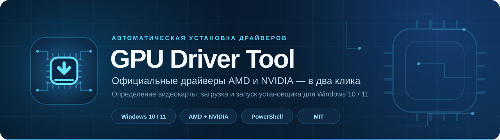
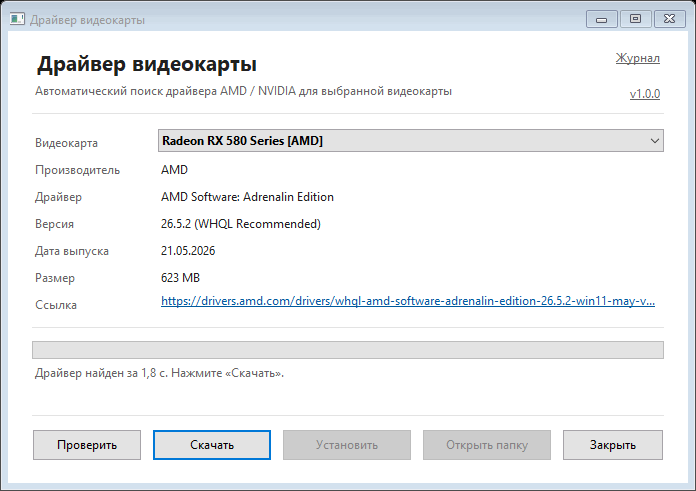
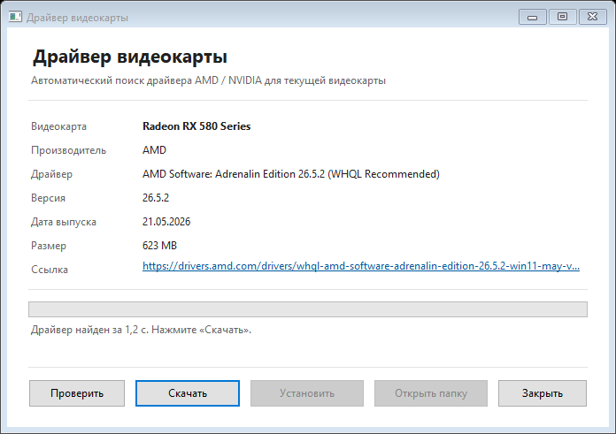
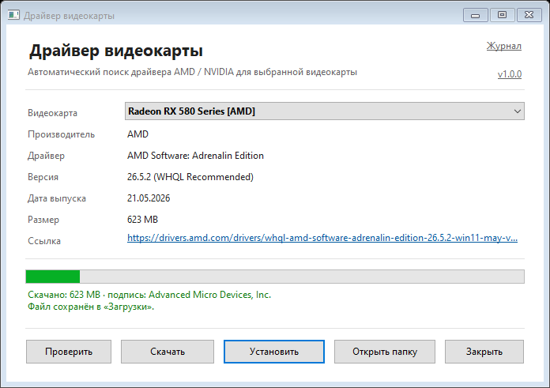

<p align="center">
  
</p>

<p align="center">
  <a href="#requirements"></a>
  <a href="#quick-start"></a>
  <a href="#features"></a>
  <a href="https://github.com/dponeNF/gpu-driver-tool/releases/latest"></a>
  <a href="https://github.com/dponeNF/gpu-driver-tool/actions/workflows/ci.yml"></a>
  <a href="LICENSE"></a>
</p>

<p align="center">
  Detects your GPU by PCI ID, finds the current driver on the official vendor website,<br>
  verifies the installer signature and helps install it without searching through support pages.
</p>

<p align="center">
  <a href="#features">Features</a> ·
  <a href="#quick-start">Quick start</a> ·
  <a href="#command-line">Command line</a> ·
  <a href="#how-it-works">How it works</a> ·
  <a href="#security">Security</a> ·
  <a href="README.md">Русский</a>
</p>

## Screenshots

<p align="center">
  <a href="screenshots/demo.gif"></a>
</p>

| Driver search | Download and signature check |
|:---:|:---:|
| [](screenshots/main.png) | [](screenshots/download.png) |
| GPU detection by PCI ID, adapter selection and driver details | Download progress, publisher verification and install step |

## Features

- **PCI ID detection.** Reads `Win32_VideoController`, extracts `VEN_`/`DEV_` from the PnP ID and reliably distinguishes AMD (`1002`) and NVIDIA (`10DE`) from virtual adapters.
- **GPU selection.** Choose the required adapter from the GUI list or with `-GpuName` in the CLI. NVIDIA is still offered first on hybrid systems.
- **Official sources only.** AMD Drivers & Support and NVIDIA Driver Downloads — no third-party mirrors or repacks.
- **Current driver.** AMD uses the WHQL/Recommended package; NVIDIA picks a suitable WHQL or DCH package for the installed Windows version.
- **Signature and integrity verification.** Before installation, Authenticode status, the exact publisher name, the root certificate in `LocalMachine\Root` and SHA-256 are checked. Invalid or foreign files are quarantined. The installer runs only from a separate staging folder after a second hash-bound verification.
- **Clear interface.** Native Windows UI, automatic search on startup and a simple flow: search → download → verify → install.
- **Progress and cancellation.** Downloads can be stopped; unfinished `.part` files are removed.
- **UAC installation.** Starts the official installer with an elevation prompt after explicit confirmation.
- **Logs and error copying.** Every stage is written to a local log. Error dialogs can copy the message or open the log.
- **Update check.** The GUI and CLI can check the latest GitHub release and offer the release page.
- **Command-line mode.** List GPUs, inspect the driver, choose an output folder, download without installing and override the GPU model.
- **No dependencies.** Windows PowerShell 5.1, built-in Windows components and four runtime files. No external modules or executables.

## Quick start

1. Click the green **Code** button at the top of the page and choose **Download ZIP**.
2. Extract the archive and run `Start-GpuDriver.bat`.
3. Wait for automatic GPU detection. If there are multiple adapters, select the required one.
4. Click **Download** (Скачать). The tool verifies the digital signature, publisher and hash, then shows the publisher.
5. Click **Install** (Установить) and confirm the UAC prompt. The AMD or NVIDIA installer completes the installation.

> Keep these files together: `Start-GpuDriver.bat`, `Get-GpuDriver-GUI.ps1`, `Get-GpuDriver.ps1` and `GpuDriverCore.ps1`.

If Windows blocks the script, open PowerShell in the project folder:

```powershell
powershell.exe -NoProfile -ExecutionPolicy Bypass -File .\Get-GpuDriver-GUI.ps1
```

Drivers are saved to `%USERPROFILE%\Downloads`. Administrator rights are required only by the vendor installer.

## Update check

Click the version link in the top-right corner of the GUI, or run:

```powershell
.\Get-GpuDriver.ps1 -CheckUpdate
```

The tool only compares the installed version with the latest GitHub release and offers to open its page. It does not download or install updates automatically.

## Logging

Log file: `%LOCALAPPDATA%\GpuDriverTool\gpu-driver.log`.

- Startup, GPU detection, search, download, signature verification, installation and errors are logged.
- The log rotates to `gpu-driver.log.old` after 1 MB.
- Error dialogs provide **Copy error** and **Open log** actions.
- The CLI prints the log path when an error occurs.

## Command line

```powershell
powershell.exe -NoProfile -ExecutionPolicy Bypass -File .\Get-GpuDriver.ps1
```

| Option | Description |
|---|---|
| `-OutDir <path>` | Driver download folder. Default: `%USERPROFILE%\Downloads`. |
| `-GpuName "<model>"` | Use the specified model instead of auto-detection. |
| `-ListGpus` | List detected AMD and NVIDIA adapters and exit. |
| `-CheckUpdate` | Check the latest GitHub release and exit. |
| `-DryRun` | Find the driver and print details without downloading. |
| `-NoInstall` | Download the driver but do not offer installation. |
| `-Force` | Overwrite an existing driver file. |

Examples:

```powershell
# List detected GPUs
.\Get-GpuDriver.ps1 -ListGpus

# Show the driver selected for the current GPU
.\Get-GpuDriver.ps1 -DryRun

# Download to a custom folder without installing
.\Get-GpuDriver.ps1 -OutDir "D:\Drivers" -NoInstall

# Look up a specific model
.\Get-GpuDriver.ps1 -GpuName "Radeon RX 580 Series" -DryRun

# Check for a tool update
.\Get-GpuDriver.ps1 -CheckUpdate
```

Example output:

```text
GPU Driver Tool v1.0.1

GPU           : Radeon RX 580 Series
Vendor        : AMD
PCI ID        : 1002:67df
Searching for driver...
Driver        : AMD Software: Adrenalin Edition 26.5.2 (WHQL Recommended)
Version       : 26.5.2
Release date  : 21.05.2026
Size          : 623 MB
URL           : https://drivers.amd.com/drivers/whql-amd-software-adrenalin-edition-26.5.2-win11-may-vega-polaris.exe
Search time   : 1.8 s
```

The actual CLI output is localized in Russian.

## How it works

1. **Hardware detection.** `Get-GpuAdapterList` reads `Win32_VideoController`, extracts PCI Vendor/Device IDs, filters virtual adapters and builds the AMD/NVIDIA list.
2. **Vendor lookup.** AMD uses the official driver catalog and model support page; NVIDIA uses the official driver lookup API.
3. **Package selection.** AMD prefers WHQL/Recommended over Optional; NVIDIA tries WHQL/DCH variants. If no exact AMD package exists, the official Auto-Detect utility is offered.
4. **Download.** The CLI and GUI use HTTPS downloads with host validation on every redirect, size and time limits, and a random temporary `.part` file that is published only after verification.
5. **Signature and integrity check.** `Get-AuthenticodeSignature` validates the chain and status; the exact publisher name and a `LocalMachine\Root` anchor are required, then SHA-256 is calculated. Only then can the installer run.
6. **Installation.** The verified file is copied to a separate staging folder, re-checked against SHA-256 and held open to prevent replacement before launch. After confirmation, the installer is started elevated; the tool waits for it to exit and never reboots the PC automatically.

## Security

- Only HTTPS URLs under `amd.com` and its subdomains, or `nvidia.com`, `geforce.com` and their subdomains, are allowed. Every redirect is checked separately; other schemes, ports and URL credentials are blocked.
- The update check contacts only `api.github.com`; the release page link must use `github.com`. No system information is sent.
- Authenticode status, the exact publisher name, a `LocalMachine\Root` anchor and SHA-256 are verified before launch. Invalid files are not started and are moved to `%LOCALAPPDATA%\GpuDriverTool\quarantine`.
- No ads, telemetry or bundled executables. The log stays local.
- Installation always requires confirmation and a Windows UAC prompt. Check the publisher in the UAC dialog.
- Release ZIP files include a published SHA-256. Verify a download with:
  ```powershell
  Get-FileHash .\gpu-driver-tool-v1.0.1.zip -Algorithm SHA256
  ```
- The PowerShell scripts themselves are not code-signed, so SmartScreen or an execution policy may show a warning. Download releases only from this repository.
- This project is not affiliated with AMD or NVIDIA. Use at your own risk.

## Limitations

- Only AMD Radeon and NVIDIA GPUs are supported. Virtual and unusual adapters are ignored.
- The GUI is localized in Russian; English documentation is available in this file.
- AMD and NVIDIA website structure may change and can require a lookup update.
- The vendor installer is not fully unattended; it may ask questions and requires a reboot.
- Signature verification may reject a file if the vendor certificate naming changes or the chain cannot be validated on the current system.

## Requirements

- Windows 10 or Windows 11 (x64);
- Windows PowerShell 5.1;
- AMD Radeon or NVIDIA GPU;
- internet connection;
- at least 1 GB of free disk space for the driver;
- administrator rights to install the driver.

## Project files

| File | Purpose |
|---|---|
| `Start-GpuDriver.bat` | Launches the GUI with a double-click. |
| `Get-GpuDriver-GUI.ps1` | WinForms graphical interface. |
| `Get-GpuDriver.ps1` | Command-line version. |
| `GpuDriverCore.ps1` | Shared GPU, driver, signature, log and update logic. |
| `.github/workflows/ci.yml` | Syntax and PSScriptAnalyzer checks in GitHub Actions. |
| `README.md` | Russian documentation. |
| `CHANGELOG.md` | Release history. |

## FAQ

**The driver was not found. What should I check?**
Make sure the AMD or NVIDIA GPU is present in Device Manager, the internet connection works, and antivirus or a proxy is not blocking vendor websites. Use `.\Get-GpuDriver.ps1 -ListGpus` to inspect detected adapters.

**Why is AMD Auto-Detect downloaded?**
Some AMD models do not have a standalone installer on their support page. In that case the official Auto-Detect utility selects the exact package at runtime.

**The file already exists. Can I reuse it?**
The GUI offers the existing file but verifies its signature and hash first. In the CLI, use `-Force` to overwrite it; the old file is not deleted until the replacement is verified.

**Why was the downloaded file blocked?**
Its signature is invalid, missing, the publisher does not match AMD/NVIDIA, or the root certificate is not trusted in `LocalMachine\Root`. The file is quarantined in `%LOCALAPPDATA%\GpuDriverTool\quarantine` and is not launched. Download the installer again from the official source.

**Does searching require administrator rights?**
No. Administrator rights are required only to start the driver installer.

**How do I check for a newer version of the tool?**
Run `.\Get-GpuDriver.ps1 -CheckUpdate` or click the version number in the top-right corner of the GUI.

---

<p align="center">
  <sub>Licensed under <a href="LICENSE">MIT</a>. AMD, Radeon, NVIDIA and GeForce are trademarks of their respective owners.</sub>
</p>
