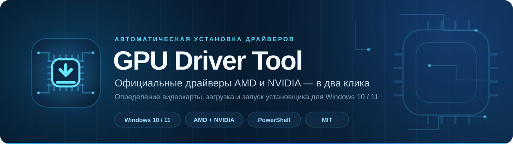
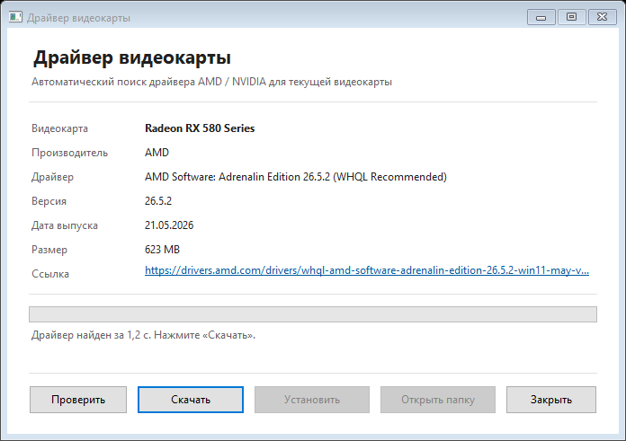
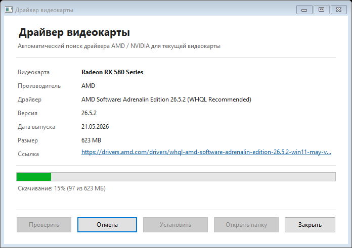

<p align="center">
  
</p>

<p align="center">
  <a href="#требования"></a>
  <a href="#быстрый-старт"></a>
  <a href="#возможности"></a>
  <a href="LICENSE"></a>
</p>

<p align="center">
  Определяет видеокарту, находит актуальный драйвер на официальном сайте производителя<br>
  и помогает скачать и установить его без ручного поиска по каталогам.
</p>

<p align="center">
  <a href="#возможности">Возможности</a> ·
  <a href="#быстрый-старт">Быстрый старт</a> ·
  <a href="#командная-строка">Командная строка</a> ·
  <a href="#как-это-работает">Как это работает</a> ·
  <a href="#безопасность">Безопасность</a>
</p>

## Скриншоты

| Поиск драйвера | Загрузка |
|:---:|:---:|
| [](screenshots/main.png) | [](screenshots/download.png) |
| Автоопределение видеокарты и информация о драйвере | Прогресс загрузки, отмена и последующая установка |

## Возможности

- **Автоматическое определение видеокарты.** Утилита находит дискретную видеокарту AMD или NVIDIA через WMI и не отвлекается на виртуальные адаптеры.
- **Только официальные источники.** AMD Drivers & Support и NVIDIA Driver Downloads — без сторонних зеркал и сборок.
- **Актуальный драйвер.** Для AMD выбирается WHQL-рекомендация, для NVIDIA — подходящий пакет с учётом версии Windows, WHQL и DCH.
- **Графический интерфейс.** Нативный вид Windows, автоматический поиск при запуске, понятные этапы: проверка → загрузка → установка.
- **Прогресс и отмена.** Загрузку можно остановить, незавершённый файл `.part` удаляется.
- **Установка через UAC.** Утилита запускает официальный установщик с запросом прав администратора и подтверждением перед стартом.
- **Режим командной строки.** Проверка драйвера, выбор папки, загрузка без установки и переопределение модели GPU.
- **Без зависимостей.** Windows PowerShell 5.1, встроенные компоненты Windows и четыре файла проекта.

## Быстрый старт

1. Жмякайте зеленую кнопку в начале страницы и нажимайте "Download ZIP"
2. Запустите `Start-GpuDriver.bat`.
3. Дождитесь автоматического определения видеокарты и нажмите **«Скачать»**.
4. После загрузки нажмите **«Установить»** и подтвердите запрос UAC. Мастер установки AMD или NVIDIA завершит установку.

> Файлы должны лежать рядом: `Start-GpuDriver.bat`, `Get-GpuDriver-GUI.ps1`, `Get-GpuDriver.ps1` и `GpuDriverCore.ps1`.

Если Windows блокирует запуск скрипта, откройте PowerShell в папке проекта:

```powershell
powershell.exe -NoProfile -ExecutionPolicy Bypass -File .\Get-GpuDriver-GUI.ps1
```

Драйвер сохраняется в `%USERPROFILE%\Downloads`. Для поиска и загрузки права администратора не нужны — они потребуются только установщику.

## Командная строка

```powershell
powershell.exe -NoProfile -ExecutionPolicy Bypass -File .\Get-GpuDriver.ps1
```

| Параметр | Описание |
|---|---|
| `-OutDir <путь>` | Папка для сохранения драйвера. По умолчанию `%USERPROFILE%\Downloads`. |
| `-GpuName "<модель>"` | Проверить драйвер для указанной модели вместо автоопределения. |
| `-DryRun` | Только найти драйвер и показать информацию, ничего не скачивать. |
| `-NoInstall` | Скачать драйвер, но не предлагать установку. |
| `-Force` | Перезаписать уже существующий файл драйвера. |

Примеры:

```powershell
# Проверить, какой драйвер предлагается для текущей видеокарты
.\Get-GpuDriver.ps1 -DryRun

# Скачать драйвер в отдельную папку без запуска установщика
.\Get-GpuDriver.ps1 -OutDir "D:\Drivers" -NoInstall

# Найти драйвер для конкретной модели
.\Get-GpuDriver.ps1 -GpuName "Radeon RX 580 Series" -DryRun
```

Пример вывода:

```text
Видеокарта    : Radeon RX 580 Series
Производитель : AMD
Драйвер       : AMD Software: Adrenalin Edition 26.5.2 (WHQL Recommended)
Версия        : 26.5.2
Дата выпуска  : 21.05.2026
Размер        : 623 MB
Ссылка        : https://drivers.amd.com/drivers/whql-amd-software-adrenalin-edition-26.5.2-win11-may-vega-polaris.exe
```

## Как это работает

1. **Определение оборудования.** `Get-GpuController` читает `Win32_VideoController`, отбрасывает виртуальные адаптеры и выбирает AMD или NVIDIA.
2. **Поиск у производителя.** Для AMD используется официальный каталог драйверов и страница модели; для NVIDIA — официальный API подбора драйверов.
3. **Выбор пакета.** AMD: WHQL/Recommended вместо Optional; NVIDIA: последовательный перебор WHQL/DCH-вариантов. Если точный пакет AMD недоступен, предлагается официальная утилита Auto-Detect.
4. **Загрузка.** CLI использует BITS с резервным `WebClient`; GUI — потоковую загрузку в фоне с прогрессом, проверкой размера и возможностью отмены.
5. **Установка.** После подтверждения запускается скачанный официальный установщик от имени администратора. Утилита ожидает завершения процесса и не перезагружает компьютер автоматически.

## Требования

- Windows 10 или Windows 11 (x64);
- Windows PowerShell 5.1;
- видеокарта AMD Radeon или NVIDIA;
- подключение к интернету;
- не менее 1 ГБ свободного места для драйвера;
- права администратора для установки драйвера.

## Файлы проекта

| Файл | Назначение |
|---|---|
| `Start-GpuDriver.bat` | Запуск графического интерфейса двойным щелчком. |
| `Get-GpuDriver-GUI.ps1` | Графический интерфейс на WinForms. |
| `Get-GpuDriver.ps1` | Консольная версия с параметрами. |
| `GpuDriverCore.ps1` | Общая логика определения GPU и поиска драйверов. |

## Безопасность

- Ссылки формируются только на домены `amd.com`, `drivers.amd.com`, `nvidia.com` и `geforce.com`.
- Утилита не содержит рекламы, телеметрии и сторонних исполняемых файлов.
- Перед установкой всегда показывается подтверждение, а Windows запрашивает UAC. Проверяйте издателя в окне UAC.
- Скачанный файл не имеет отдельной проверки контрольной суммы: официальный установщик подписан производителем, но целостность рекомендуется проверять средствами Windows.
- Проект не связан с AMD или NVIDIA. Используйте на свой риск.

## Ограничения

- Обрабатывается одна видеокарта: при гибридной графике приоритет отдаётся NVIDIA.
- Интерфейс рассчитан на русскоязычную Windows.
- Структура сайтов AMD и NVIDIA может меняться — в этом случае поиск может потребовать обновления.
- Установщик не работает в полностью автоматическом режиме: мастер AMD/NVIDIA может задавать вопросы и требует перезагрузку.
- Поддерживаются только официальные драйверы и только Windows.

## Частые вопросы

**Драйвер не найден. Что проверить?**
Убедитесь, что видеокарта AMD или NVIDIA определена в Диспетчере устройств, есть доступ к интернету, а антивирус или прокси не блокируют запросы к сайтам производителей.

**Почему скачивается AMD Auto-Detect?**
Для некоторых моделей AMD не публикует отдельный установщик на странице поддержки. В этом случае используется официальная утилита Auto-Detect: она сама определит точный пакет при запуске.

**Файл уже существует. Можно не скачивать заново?**
GUI предложит использовать существующий файл. В CLI добавьте `-Force`, если нужно перезаписать его.

**Нужны права администратора для поиска?**
Нет. Права нужны только для запуска установщика драйвера.

---

<p align="center">
  <sub>Распространяется по лицензии <a href="LICENSE">MIT</a>. AMD, Radeon, NVIDIA и GeForce — товарные знаки соответствующих владельцев.</sub>
</p>
